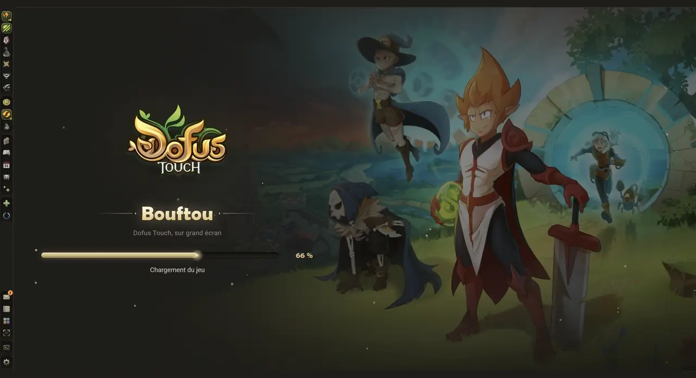
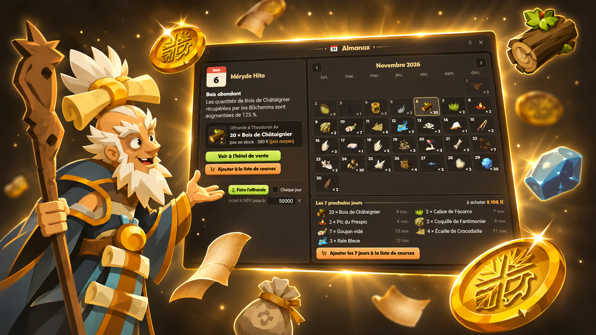

<div align="center">



<a id="espanol"></a>

# 🐑 Bouftou — Dofus Touch en PC, Mac y Linux sin emulador   

**Juega Dofus Touch en PC Windows, Mac y Linux sin emulador Android, en español, inglés o francés.** Usa tu cuenta Ankama y tus personajes habituales en los servidores oficiales, con multicuenta, pantalla dividida y herramientas integradas.

[](README.md#english)
[](README.fr.md#francais)
[](README.es.md#espanol)

[](https://discord.gg/EmYwPHEqZH)
[](https://github.com/Wayomingg/Bouftou-Dofus-Touch-PC/releases/latest)
[](https://github.com/Wayomingg/Bouftou-Dofus-Touch-PC/releases/latest)

[](https://github.com/Wayomingg/Bouftou-Dofus-Touch-PC/releases/latest/download/Installer-Bouftou.exe)
[](#instalacion)
[][telechargement-linux]

[](https://www.virustotal.com/gui/file/32675f104d0c78d6679d10f01f490b9436847212f612fa4b6480fd22ec304ff7)

</div>

> [!NOTE]
> **Bouftou no es un servidor privado.** Juegas al verdadero Dofus Touch en **los servidores oficiales de Ankama**, con tu cuenta y tus personajes habituales. Tu progreso es el mismo que en tu teléfono.

> [!IMPORTANT]
> **Cuidado con las copias.** Las fuentes oficiales de descarga son **este repositorio** y el **[Discord de Bouftou](https://discord.gg/EmYwPHEqZH)**. Nunca compartas tu contraseña de Ankama ni tu código Shield con nadie.

## 📸 Capturas

Las capturas de abajo muestran la interfaz francesa. Bouftou también está disponible en español e inglés.

<table>
  <tr>
    <td width="50%"><br><sub><b>📚 Guías de mazmorras</b>: mazmorras por nivel, con sus jefes.</sub></td>
    <td width="50%"><br><sub><b>🐉 Guías de jefes</b>: estrategias, características, resistencias, hechizos y botín.</sub></td>
  </tr>
  <tr>
    <td width="50%"><br><sub><b>🛡️ Stuffer</b>: equipos, conjuntos y características sin salir del juego.</sub></td>
    <td width="50%"><br><sub><b>📖 Enciclopedia</b>: objetos, efectos, precios del mercadillo, fabricación y trituración.</sub></td>
  </tr>
  <tr>
    <td width="50%"><br><sub><b>🗺️ Zonas rentables</b>: compara zonas por kamas esperados por monstruo y botines de valor.</sub></td>
    <td width="50%"><br><sub><b>✨ Skinator</b>: prueba apariencias en tu personaje.</sub></td>
  </tr>
  <tr>
    <td width="50%"><br><sub><b>🚀 Launcher</b>: tus juegos, personajes y herramientas antes de entrar al juego.</sub></td>
    <td width="50%"><br><sub><b>🎮 En juego</b>: pestañas de personajes, herramientas en la barra izquierda y minimapa.</sub></td>
  </tr>
</table>

<p align="center">
  
  
  
  
  
  
</p>

## ✨ Funciones

- **Español, inglés y francés:** cambia de idioma en Configuración o con la bandera de la barra izquierda del juego.
- **Más de 50 mejoras de comodidad:** información al pasar el mouse, atajos de teclado, animaciones de combate aceleradas, estados y barras de vida sobre los combatientes.
- **Forjamagia inteligente:** define los objetivos de tu equipo y deja que Bouftou elija y coloque las runas.
- **Piloto automático:** elige un destino y tu personaje viajará hasta allí usando zaaps y otros transportes.
- **Asistente del Conde Kontatrás:** encuentra la casilla correcta a la que apuntar a pesar de la confusión del Conde.
- **Enciclopedia:** consulta objetos, recetas y oportunidades de fabricación y trituración rentables.
- **Stuffer, simulador de equipos:** prepara tus equipos, compara características y daños de hechizos, y usa el optimizador para encontrar una combinación para tu clase.
- **Zonas rentables:** compara zonas de farmeo según los precios del mercadillo de tu servidor.
- **Seguimiento del mercadillo:** sigue los precios, las oportunidades de inversión y las ofertas que bajan de las tuyas.
- **Almanax:** consulta las ofrendas del día y el calendario, y prepara tu lista de compras. La ofrenda automática está desactivada temporalmente.
- **Guías de mazmorras:** mecánicas de los jefes, hechizos, resistencias, acceso y botín, con 97 estrategias traducidas al inglés y al español.
- **Skinator:** prueba sombreros, capas, escudos, mascotas y colores en tu personaje, y guarda tus apariencias favoritas.
- **Multicuenta y pantalla dividida:** organiza tus personajes en pestañas o en pantalla dividida, en Windows, Mac y Linux.
- **Inventario compartido:** consulta los objetos, los kamas y los pods de tu grupo en un solo panel.
- **Mensajería unificada:** lee y responde a los mensajes privados de tus personajes sin cambiar de pestaña.

## 🔁 ¿Buscas una alternativa a Lindo?

Bouftou ejecuta Dofus Touch en tu computadora sin un emulador Android como BlueStacks o LDPlayer. Añade multicuenta en pestañas, pantalla dividida, forjamagia inteligente, piloto automático, Stuffer, guías de mazmorras y otras herramientas. Las actualizaciones son automáticas, con espacios de ayuda en español, inglés y francés en Discord.

## 🔍 Cómo funciona

1. **Descarga:** Bouftou obtiene los archivos de Dofus Touch directamente de Ankama, como la aplicación móvil.
2. **Adaptación a la computadora:** los parches de compatibilidad adaptan el juego a una ventana de escritorio y convierten los clics del mouse en toques.
3. **Ejecución local:** el juego se ejecuta desde tu computadora y se actualiza cuando Ankama publica nuevos archivos.
4. **Tu cuenta Ankama se queda en Ankama:** inicia sesión como siempre. Tu contraseña, tu código Shield y el tráfico del juego no pasan por los servidores de Bouftou.

Bouftou envía a sus propios servidores tu cuenta Discord para verificar tu acceso, los juegos abiertos y tu versión de Bouftou mientras juegas, y un informe de error solo si eliges enviarlo.

<a id="instalacion"></a>

## 💻 Descarga e instalación

| Sistema | Archivo | Descarga |
|---|---|---|
| **Windows 10 / 11**, 64 bits | `Installer-Bouftou.exe` | [Descargar para Windows](https://github.com/Wayomingg/Bouftou-Dofus-Touch-PC/releases/latest/download/Installer-Bouftou.exe) |
| **macOS 12 o posterior**, Apple Silicon o Intel | `.dmg` | [Apple Silicon][telechargement-mac-apple] · [Intel][telechargement-mac-intel] |
| **Linux**, 64 bits | `.AppImage` | [Descargar AppImage][telechargement-linux] |

1. Instala Bouftou para tu sistema.
2. Inicia sesión con Discord para verificar tu acceso. **El pase de Bouftou se compra en la tienda de Discord.** Consulta la tienda para ver los precios actuales.
3. Elige **Español** en **Configuración › General** o con la bandera de la barra izquierda.
4. Abre Dofus Touch e inicia sesión con tu cuenta Ankama habitual.

Bouftou se actualiza automáticamente en los tres sistemas.

<a id="windows"></a>

**Windows:** el instalador no tiene firma digital. Si SmartScreen muestra «Windows protegió su PC», elige **Más información → Ejecutar de todas formas**, después de comprobar que lo descargaste de una fuente oficial.

**Mac:** abre el `.dmg` y arrastra Bouftou a **Aplicaciones**. Si macOS no puede verificar la aplicación, abre **Configuración del Sistema › Privacidad y seguridad** y selecciona **Abrir de todos modos**.

**Linux:** guarda el `.AppImage` en una carpeta tuya, como `~/Applications`, dale permiso de ejecución (`chmod +x Bouftou-*.AppImage`, o clic derecho › Propiedades) y ábrelo. Ubuntu 22.04 y versiones posteriores pueden necesitar `libfuse2`.

**Verifica tu descarga:** la huella SHA-256 y el enlace VirusTotal del instalador de Windows están en las [notas de versión](https://github.com/Wayomingg/Bouftou-Dofus-Touch-PC/releases). Para comprobar la huella en PowerShell:

```powershell
Get-FileHash .\Installer-Bouftou.exe -Algorithm SHA256
```

Si no coincide con la huella publicada, no abras el archivo y contáctanos en Discord.

<a id="faq"></a>

## ❓ Preguntas frecuentes

**¿Es un servidor privado?** No. Juegas a Dofus Touch en los servidores oficiales de Ankama con tu cuenta y tus personajes habituales.

**¿Necesito un emulador Android?** No. Bouftou descarga los archivos del juego desde Ankama y los adapta a una ventana de escritorio.

**¿Puedo usar varias cuentas?** Sí. Usa las pestañas de personajes o la pantalla dividida dentro de Bouftou.

**¿Qué sistemas son compatibles?** Windows 10 y 11 de 64 bits, macOS 12 o posterior con Apple Silicon o Intel, y Linux de 64 bits. Consulta la [instalación](#instalacion).

**¿Y mi cuenta Ankama?** Inicia sesión como siempre en el juego. Nunca compartas tu contraseña ni tu código Shield, ni siquiera con alguien que diga ser del equipo de Bouftou.

**¿Qué idiomas están disponibles?** Español, inglés y francés. Cambia el idioma en **Configuración › General** o con la bandera de la barra izquierda del juego.

**¿Dónde veo las novedades?** En la pestaña de notas del parche del launcher y en el canal de notas del parche de tu idioma en Discord.

**¿Dónde puedo reportar un error o hacer una sugerencia?** En la configuración de Bouftou o en el [Discord de Bouftou](https://discord.gg/EmYwPHEqZH), con espacios de ayuda en español, inglés y francés.

---

<div align="center">

**[Únete a la comunidad en Discord](https://discord.gg/EmYwPHEqZH)** 🐑

⭐ *¿Te gusta Bouftou? Una estrella en este repositorio ayuda a otros jugadores a encontrarlo.*

<sub>Proyecto independiente, no oficial y no afiliado a Ankama. Dofus Touch es una marca de Ankama.</sub>

</div>

[telechargement-mac-apple]: https://bouftou-boutique.discord-boutique.workers.dev/telecharger/installateur/0.4.37/Bouftou-0.4.37-mac-arm64.dmg
[telechargement-mac-intel]: https://bouftou-boutique.discord-boutique.workers.dev/telecharger/installateur/0.4.37/Bouftou-0.4.37-mac-x64.dmg
[telechargement-linux]: https://bouftou-boutique.discord-boutique.workers.dev/telecharger/installateur/0.4.37/Bouftou-0.4.37-linux-x64.AppImage
