<div align="center">

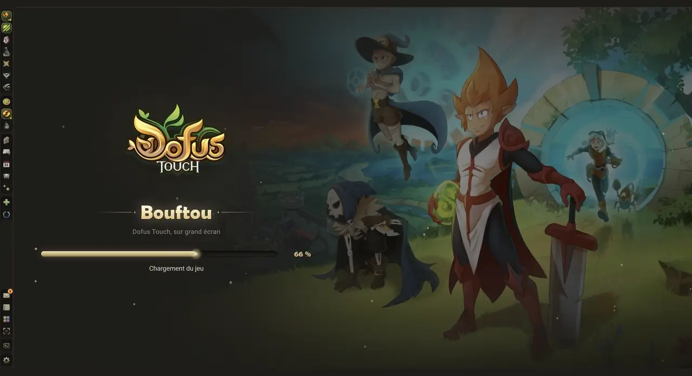

<a id="francais"></a>

# 🐑 Bouftou — Dofus Touch sur PC, Mac et Linux, sans émulateur   

**Joue à Dofus Touch sur PC Windows, Mac et Linux, sans émulateur Android, en français, en anglais ou en espagnol.** Bouftou adapte le jeu à la souris et au clavier, avec des outils intégrés pour tes équipements, tes déplacements, tes combats et tes comptes. Tu retrouves les serveurs officiels d’Ankama et tes personnages habituels.

[](README.md#english)
[](README.fr.md#francais)
[](README.es.md#espanol)

[](https://discord.gg/EmYwPHEqZH)
[](https://github.com/Wayomingg/Bouftou-Dofus-Touch-PC/releases/latest)
[](https://github.com/Wayomingg/Bouftou-Dofus-Touch-PC/releases/latest)

[](https://github.com/Wayomingg/Bouftou-Dofus-Touch-PC/releases/latest/download/Installer-Bouftou.exe)
[](#installation)
[][telechargement-linux]

[](https://www.virustotal.com/gui/file/d405e1cd67056f4b1114c2ec5b4c0bc142ea37934e9f3197ce3f7d0ac651a045)

</div>

> [!NOTE]
> **Bouftou n’est pas un serveur privé.** Tu joues au vrai Dofus Touch sur **les serveurs officiels d’Ankama**, avec ton compte et tes personnages habituels. Ta progression est la même que sur ton téléphone.

> [!IMPORTANT]
> **Méfie-toi des copies.** Les sources officielles de téléchargement sont **ce dépôt** et le **[Discord de Bouftou](https://discord.gg/EmYwPHEqZH)**. Ne donne jamais ton mot de passe Ankama ni ton code Shield à personne.

## 📸 Captures

Les captures ci-dessous montrent l’interface française. Bouftou est aussi disponible en anglais et en espagnol.

<table>
  <tr>
    <td width="50%">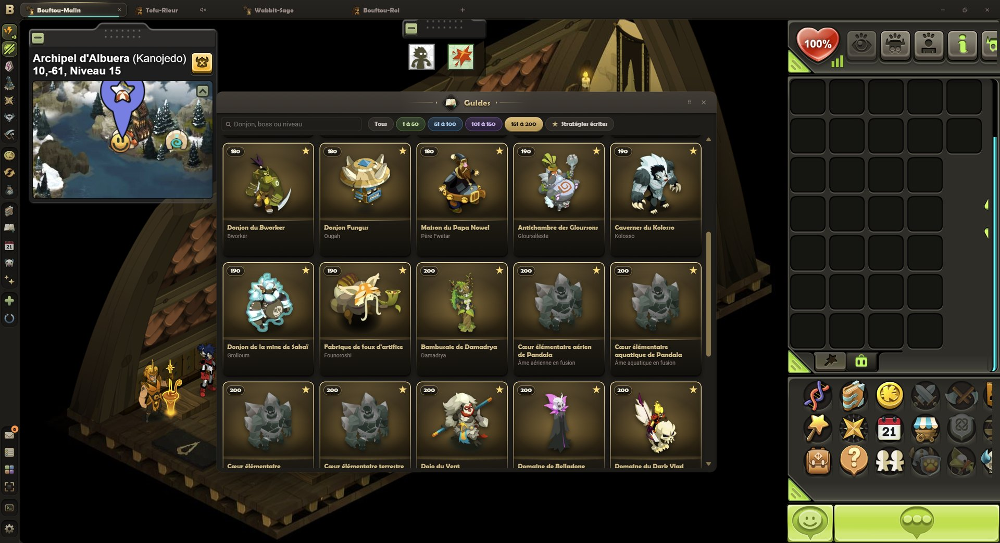<br><sub><b>📚 Guides des donjons</b> : les donjons classés par niveau, avec leurs boss.</sub></td>
    <td width="50%">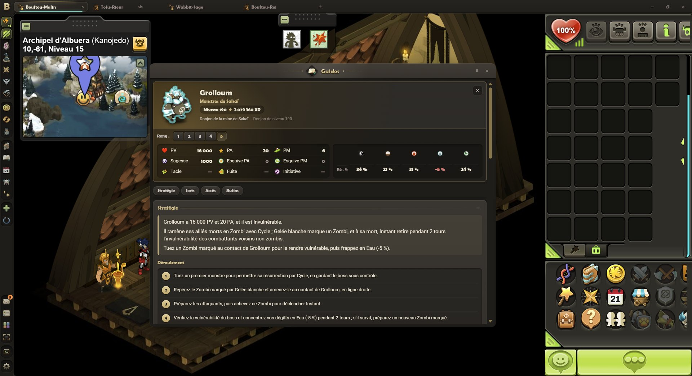<br><sub><b>🐉 Guides des boss</b> : stratégies, caractéristiques, résistances, sorts et butins.</sub></td>
  </tr>
  <tr>
    <td width="50%">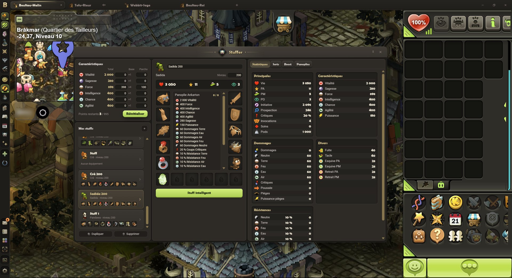<br><sub><b>🛡️ Stuffer</b> : équipements, panoplies et caractéristiques sans quitter le jeu.</sub></td>
    <td width="50%">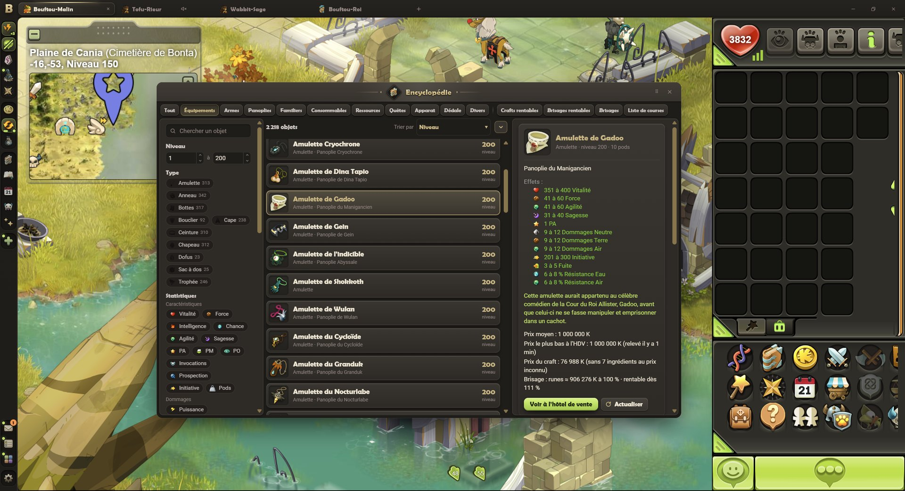<br><sub><b>📖 Encyclopédie</b> : objets, effets, prix du marché, craft et brisage.</sub></td>
  </tr>
  <tr>
    <td width="50%">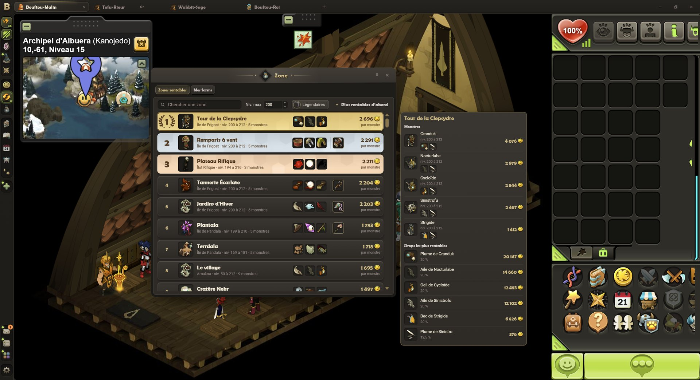<br><sub><b>🗺️ Zones rentables</b> : compare les zones selon les kamas espérés par monstre et les drops de valeur.</sub></td>
    <td width="50%">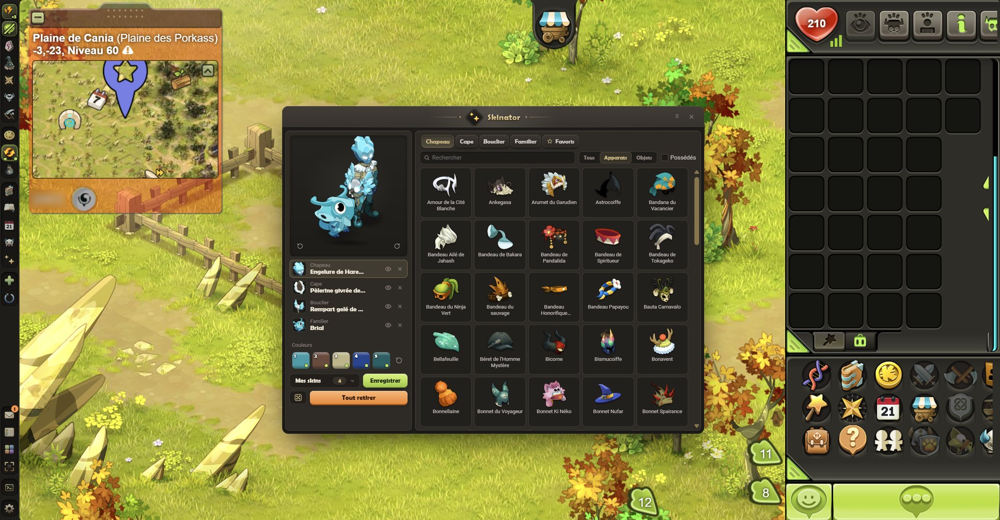<br><sub><b>✨ Skinator</b> : essaie les apparats sur ton personnage.</sub></td>
  </tr>
  <tr>
    <td width="50%"><br><sub><b>🚀 Lanceur</b> : tes jeux, tes personnages et tes outils avant d’entrer en jeu.</sub></td>
    <td width="50%"><br><sub><b>🎮 En jeu</b> : onglets des personnages, outils dans la barre de gauche et mini-carte.</sub></td>
  </tr>
</table>

<p align="center">
  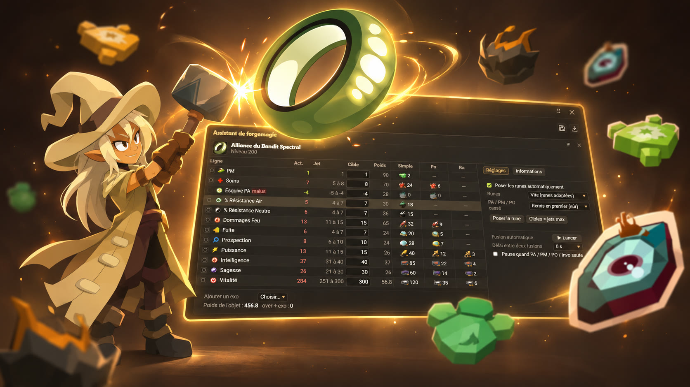
  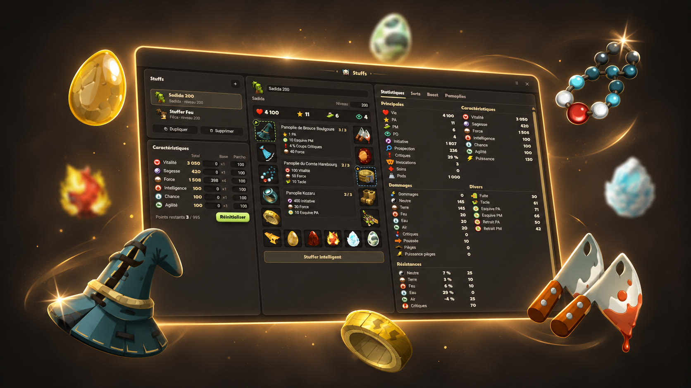
  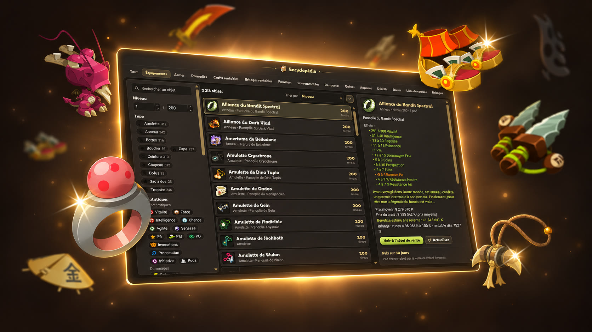
  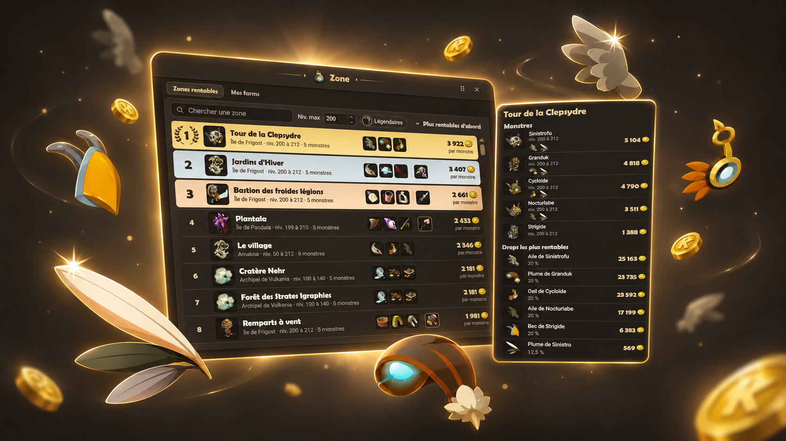
  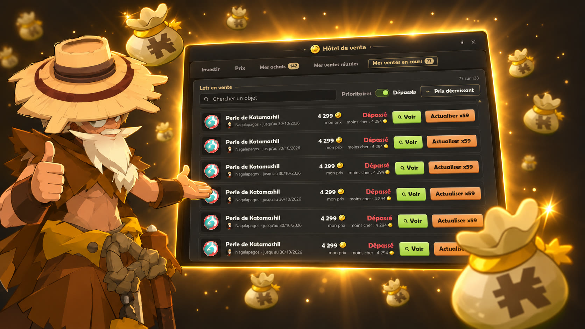
  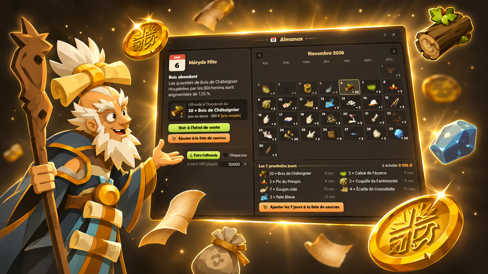
</p>

## ✨ Fonctionnalités

- **Français, anglais et espagnol :** change de langue dans les Paramètres ou avec le drapeau de la barre de gauche du jeu.
- **Plus de 50 améliorations de confort :** informations au survol, raccourcis clavier, animations de combat accélérées, états et barres de vie au-dessus des combattants.
- **Forgemagie intelligente :** fixe les objectifs de ton équipement, Bouftou choisit et pose les runes pour toi.
- **Pilote automatique :** choisis une destination, ton personnage s’y rend avec les zaaps et les autres transports.
- **Assistant Harebourg :** trouve la bonne case à viser malgré la confusion du Comte.
- **Encyclopédie :** consulte les objets, les recettes et les possibilités de craft et de brisage rentables.
- **Stuffer :** prépare tes équipements, compare les caractéristiques et les dégâts des sorts, et utilise l’optimiseur pour trouver un stuff adapté à ta classe.
- **Zones rentables :** compare les zones de farm selon les prix du marché de ton serveur.
- **Veille du marché :** suis les prix, les possibilités d’investissement et les offres qui passent sous les tiennes.
- **Almanax :** consulte les offrandes du jour et le calendrier, et prépare ta liste de courses. L’offrande automatique est temporairement désactivée.
- **Guides des donjons :** mécaniques des boss, sorts, résistances, accès et butins, avec 97 stratégies traduites en anglais et en espagnol.
- **Skinator :** essaie chapeaux, capes, boucliers, familiers et couleurs sur ton personnage, puis garde tes tenues préférées.
- **Multicompte et écran partagé :** organise tes personnages en onglets ou en écran partagé, sur Windows, Mac et Linux.
- **Inventaire partagé :** consulte les objets, les kamas et les pods de ton groupe dans un seul panneau.
- **Messagerie unifiée :** lis les messages privés de tes personnages et réponds sans changer d’onglet.

## 🔁 Tu cherches une alternative à Lindo ?

Bouftou fait tourner Dofus Touch sur ton ordinateur sans émulateur Android comme BlueStacks ou LDPlayer. Il ajoute le multicompte en onglets, l’écran partagé, la forgemagie intelligente, le pilote automatique, le Stuffer, les Guides des donjons et d’autres outils. Les mises à jour sont automatiques, avec des espaces d’aide en français, en anglais et en espagnol sur Discord.

## 🔍 Comment ça marche

1. **Téléchargement :** Bouftou récupère les fichiers de Dofus Touch directement chez Ankama, comme l’application mobile.
2. **Adaptation au PC :** des correctifs adaptent le jeu à une fenêtre d’ordinateur et transforment les clics de souris en touchers.
3. **Exécution locale :** le jeu tourne depuis ton ordinateur et se met à jour quand Ankama publie de nouveaux fichiers.
4. **Ton compte Ankama reste chez Ankama :** connecte-toi comme d’habitude. Ton mot de passe, ton code Shield et les échanges du jeu ne passent pas par les serveurs de Bouftou.

Bouftou envoie à ses propres serveurs ton compte Discord pour vérifier ton accès, les jeux ouverts et ta version de Bouftou pendant que tu joues, et un rapport de bug seulement si tu choisis d’en envoyer un.

<a id="installation"></a>

## 💻 Téléchargement et installation

| Système | Fichier | Téléchargement |
|---|---|---|
| **Windows 10 / 11**, 64 bits | `Installer-Bouftou.exe` | [Télécharger pour Windows](https://github.com/Wayomingg/Bouftou-Dofus-Touch-PC/releases/latest/download/Installer-Bouftou.exe) |
| **macOS 12 ou plus récent**, puce Apple ou Intel | `.dmg` | [Puce Apple][telechargement-mac-apple] · [Intel][telechargement-mac-intel] |
| **Linux**, 64 bits | `.AppImage` | [Télécharger AppImage][telechargement-linux] |

1. Installe Bouftou pour ton système.
2. Connecte-toi avec Discord pour vérifier ton accès. **Le pass de Bouftou s’achète dans la boutique Discord.** Consulte la boutique pour les tarifs actuels.
3. Choisis **Français** dans **Paramètres › Général** ou avec le drapeau de la barre de gauche.
4. Lance Dofus Touch et connecte-toi avec ton compte Ankama habituel.

Bouftou se met ensuite à jour automatiquement sur les trois systèmes.

<a id="windows"></a>

**Windows :** l’installateur n’a pas de signature numérique. Si SmartScreen affiche « Windows a protégé votre ordinateur », choisis **Informations complémentaires → Exécuter quand même**, après avoir vérifié que tu l’as téléchargé depuis une source officielle.

**Mac :** ouvre le `.dmg` et glisse Bouftou dans **Applications**. Si macOS ne peut pas vérifier l’application, ouvre **Réglages Système › Confidentialité et sécurité**, puis choisis **Ouvrir quand même**.

**Linux :** place le `.AppImage` dans un dossier à toi, comme `~/Applications`, rends-le exécutable (`chmod +x Bouftou-*.AppImage`, ou clic droit › Propriétés), puis lance-le. Sur Ubuntu 22.04 et plus récent, `libfuse2` peut être nécessaire.

**Vérifier ton téléchargement :** l’empreinte SHA-256 et le lien VirusTotal de l’installateur Windows se trouvent dans les [notes de version](https://github.com/Wayomingg/Bouftou-Dofus-Touch-PC/releases). Pour vérifier l’empreinte dans PowerShell :

```powershell
Get-FileHash .\Installer-Bouftou.exe -Algorithm SHA256
```

Si elle ne correspond pas à l’empreinte publiée, ne lance pas le fichier et contacte-nous sur Discord.

<a id="faq"></a>

## ❓ Questions fréquentes

**C’est un serveur privé ?** Non. Tu joues à Dofus Touch sur les serveurs officiels d’Ankama avec ton compte et tes personnages habituels.

**Faut-il un émulateur Android ?** Non. Bouftou télécharge les fichiers du jeu chez Ankama et les adapte à une fenêtre d’ordinateur.

**Puis-je utiliser plusieurs comptes ?** Oui. Utilise les onglets des personnages ou l’écran partagé dans Bouftou.

**Quels systèmes sont compatibles ?** Windows 10 et 11 en 64 bits, macOS 12 ou plus récent avec puce Apple ou Intel, et Linux en 64 bits. Consulte [l’installation](#installation).

**Et mon compte Ankama ?** Connecte-toi comme d’habitude dans le jeu. Ne donne jamais ton mot de passe ni ton code Shield, même à quelqu’un qui se présente comme l’équipe Bouftou.

**Quelles langues sont disponibles ?** Français, anglais et espagnol. Change de langue dans **Paramètres › Général** ou avec le drapeau de la barre de gauche du jeu.

**Où voir les nouveautés ?** Dans l’onglet des notes de patch du lanceur et dans le salon des notes de patch de ta langue sur Discord.

**Où signaler un bug ou faire une suggestion ?** Dans les Paramètres de Bouftou ou sur le [Discord de Bouftou](https://discord.gg/EmYwPHEqZH), avec des espaces d’aide en français, en anglais et en espagnol.

---

<div align="center">

**[Rejoins la communauté sur Discord](https://discord.gg/EmYwPHEqZH)** 🐑

⭐ *Bouftou te plaît ? Une étoile sur ce dépôt aide d’autres joueurs à le trouver.*

<sub>Projet indépendant, non officiel et non affilié à Ankama. Dofus Touch est une marque d’Ankama.</sub>

</div>

[telechargement-mac-apple]: https://bouftou-boutique.discord-boutique.workers.dev/telecharger/installateur/0.4.41/Bouftou-0.4.41-mac-arm64.dmg
[telechargement-mac-intel]: https://bouftou-boutique.discord-boutique.workers.dev/telecharger/installateur/0.4.41/Bouftou-0.4.41-mac-x64.dmg
[telechargement-linux]: https://bouftou-boutique.discord-boutique.workers.dev/telecharger/installateur/0.4.41/Bouftou-0.4.41-linux-x64.AppImage
