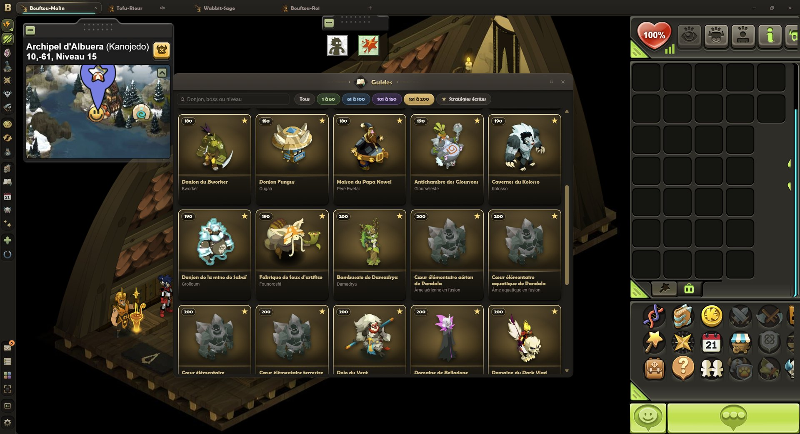
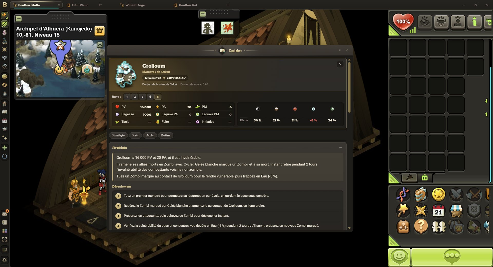
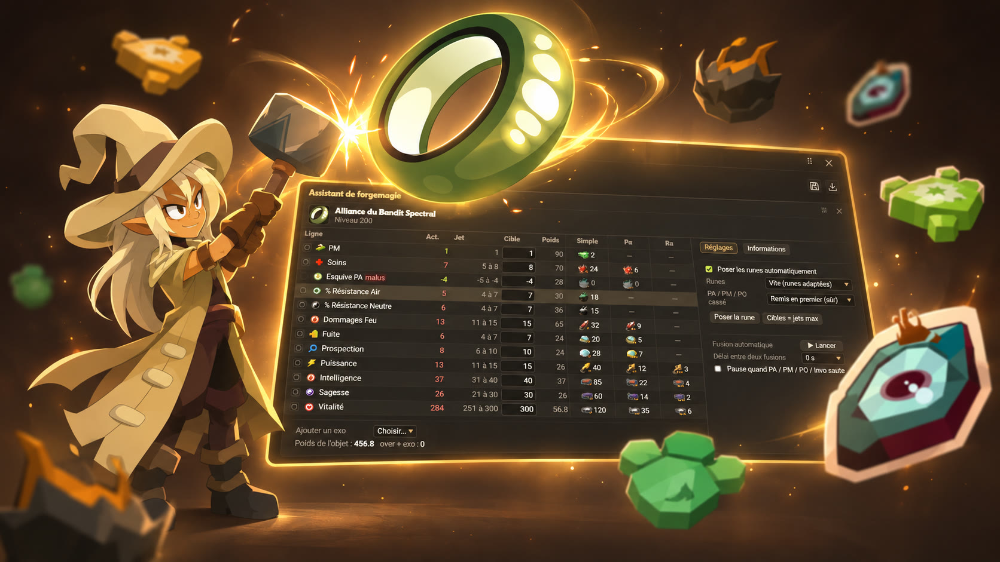
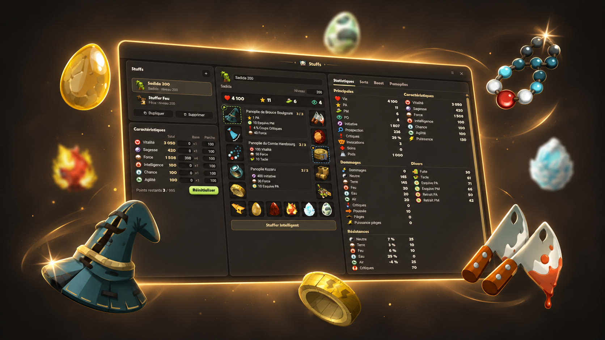
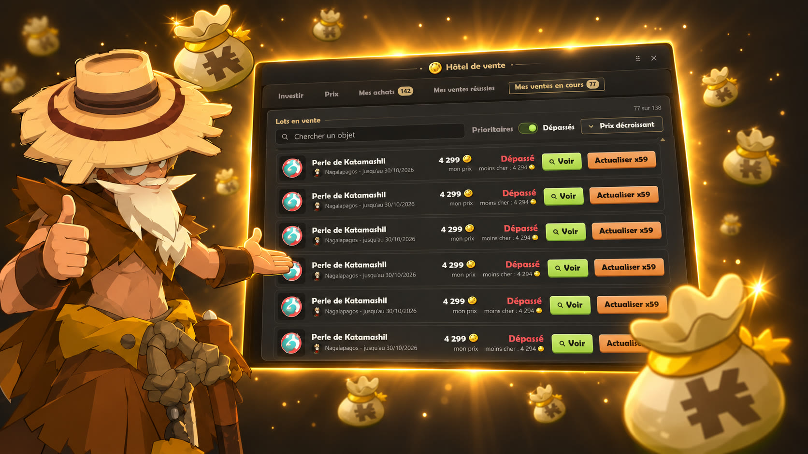

<div align="center">


<a id="english"></a>

# 🐑 Bouftou — Dofus Touch on PC, Mac and Linux, without an emulator   

**Play Dofus Touch on PC (Windows), Mac and Linux without an Android emulator, in English, French or Spanish.** Bouftou brings mouse and keyboard controls, multi-account tabs, split screen and built-in tools for your gear, travel, combat and characters. Play on Ankama’s official servers with your usual account.

[](README.md#english)
[](README.fr.md#francais)
[](README.es.md#espanol)

[](https://discord.gg/EmYwPHEqZH)
[](https://github.com/Wayomingg/Bouftou-Dofus-Touch-PC/releases/latest)
[](https://github.com/Wayomingg/Bouftou-Dofus-Touch-PC/releases/latest)

[](https://github.com/Wayomingg/Bouftou-Dofus-Touch-PC/releases/latest/download/Installer-Bouftou.exe)
[](#installation)
[][telechargement-linux]

[](https://www.virustotal.com/gui/file/5f1c34c34c876061837b8598103f3c181befa613d39f908abd08c8d83dd91e85)

</div>

> [!NOTE]
> **Bouftou is not a private server.** You play the real Dofus Touch on **Ankama's official servers**, with your usual account and characters. Your progress is the same as on your phone.

> [!IMPORTANT]
> **Watch out for copies.** Bouftou's official download sources are **this repository** and the **[Bouftou Discord](https://discord.gg/EmYwPHEqZH)**. Never share your Ankama password or Shield code with anyone.

## 📸 Screenshots

The screenshots below show the French interface. Bouftou is also available in English and Spanish.

<table>
  <tr>
    <td width="50%"><br><sub><b>📚 Dungeon guides</b>: dungeons by level, with their bosses.</sub></td>
    <td width="50%"><br><sub><b>🐉 Boss guides</b>: strategies, stats, resistances, spells and loot.</sub></td>
  </tr>
  <tr>
    <td width="50%"><br><sub><b>🛡️ Stuffer</b>: equipment, sets and character stats without leaving the game.</sub></td>
    <td width="50%"><br><sub><b>📖 Encyclopedia</b>: items, effects, market prices, crafting and rune crushing.</sub></td>
  </tr>
  <tr>
    <td width="50%"><br><sub><b>🗺️ Farming zones</b>: compare areas by expected kamas per monster and valuable drops.</sub></td>
    <td width="50%"><br><sub><b>✨ Skinator</b>: try cosmetics on your character.</sub></td>
  </tr>
  <tr>
    <td width="50%"><br><sub><b>🚀 Launcher</b>: your games, characters and tools before entering the game.</sub></td>
    <td width="50%"><br><sub><b>🎮 In game</b>: character tabs, tools in the left sidebar and the minimap.</sub></td>
  </tr>
</table>

<p align="center">
  
  
  
  
  
  
</p>

## ✨ Features

- **English, French and Spanish:** switch languages in Settings or with the flag in the game's left sidebar.
- **50+ quality-of-life improvements:** hover information, keyboard shortcuts, faster combat animations, status icons and health bars above fighters.
- **Smart forgemaging:** set your equipment targets and let Bouftou choose and apply the runes.
- **Autopilot:** pick a destination and let your character travel there, using zaaps and other transport.
- **Count Harebourg assistant:** find the right cell to target despite the Count's confusion mechanic.
- **Item encyclopedia:** browse items, recipes, crafting and rune-crushing opportunities.
- **Stuffer gear builder:** plan equipment, compare stats and spell damage, and use the gear optimizer to find a setup for your class.
- **Profitable farming zones:** compare areas using your server's market prices.
- **Market tracking:** follow prices, investment opportunities and listings that undercut yours.
- **Almanax:** check daily offerings, browse the calendar and prepare a shopping list. Automatic offerings are temporarily disabled.
- **Dungeon guides:** boss mechanics, spells, resistances, access and loot, with 97 strategies translated into English and Spanish.
- **Skinator:** try hats, capes, shields, pets and character colors, then save your favorite looks.
- **Multi-account tabs and split screen:** organize your characters in one desktop interface on Windows, Mac and Linux.
- **Shared inventory:** see your group's items, kamas and carrying capacity in one panel.
- **Unified messaging:** read and reply to your characters' private messages without switching tabs.

## 🔁 Looking for a Lindo alternative?

Bouftou runs Dofus Touch on your computer without an Android emulator such as BlueStacks or LDPlayer. It adds multi-account tabs, split screen, smart forgemaging, an autopilot, a gear builder, dungeon guides and other tools. Updates are automatic, with English, French and Spanish support spaces on Discord.

## 🔍 How it works

1. **Download:** Bouftou fetches Dofus Touch's game files directly from Ankama, as the mobile app does.
2. **Desktop compatibility:** compatibility patches adapt the game to a desktop window and turn mouse clicks into touch input.
3. **Local execution:** the game runs from your own computer and updates when Ankama releases new game files.
4. **Your Ankama account stays with Ankama:** sign in as usual. Your password, Shield code and game traffic do not pass through Bouftou's servers.

Bouftou sends its own servers your Discord account to verify access, the games you have open and your Bouftou version while playing, and a bug report only if you choose to send one.

<a id="installation"></a>

## 💻 Download and installation

| Platform | File | Download |
|---|---|---|
| **Windows 10 / 11**, 64-bit | `Installer-Bouftou.exe` | [Download for Windows](https://github.com/Wayomingg/Bouftou-Dofus-Touch-PC/releases/latest/download/Installer-Bouftou.exe) |
| **macOS 12 or later**, Apple Silicon or Intel | `.dmg` | [Apple Silicon][telechargement-mac-apple] · [Intel][telechargement-mac-intel] |
| **Linux**, 64-bit | `.AppImage` | [Download AppImage][telechargement-linux] |

1. Install Bouftou for your platform.
2. Sign in with Discord to verify your access. **A Bouftou pass is purchased through the Discord store.** Check the store for current prices.
3. Choose **English** in **Settings › General** or using the flag in the left sidebar.
4. Launch Dofus Touch and sign in with your usual Ankama account.

Bouftou updates automatically on all three platforms.

<a id="windows"></a>

**Windows:** the installer is not code-signed. If SmartScreen shows “Windows protected your PC”, choose **More info → Run anyway** after checking that you downloaded it from an official source.

**Mac:** open the `.dmg` and drag Bouftou to **Applications**. If macOS cannot verify the app, open **System Settings › Privacy & Security** and select **Open Anyway**.

**Linux:** put the `.AppImage` in a folder you own, such as `~/Applications`, make it executable (`chmod +x Bouftou-*.AppImage`, or right-click › Properties), then launch it. Ubuntu 22.04 and later may require `libfuse2`.

**Verify your download:** the Windows installer's SHA-256 checksum and VirusTotal link are listed in the [release notes](https://github.com/Wayomingg/Bouftou-Dofus-Touch-PC/releases). To check the checksum in PowerShell:

```powershell
Get-FileHash .\Installer-Bouftou.exe -Algorithm SHA256
```

If it does not match the published checksum, do not run the file and contact us on Discord.

<a id="faq"></a>

## ❓ FAQ

**Is this a private server?** No. You play Dofus Touch on Ankama's official servers with your usual account and characters.

**Do I need an Android emulator?** No. Bouftou downloads the game files from Ankama and adapts them to a desktop window.

**Can I use several accounts?** Yes. Use character tabs or split screen within Bouftou.

**Which systems are supported?** Windows 10 and 11 (64-bit), macOS 12 or later on Apple Silicon or Intel, and 64-bit Linux. See [installation](#installation).

**What about my Ankama account?** Sign in as usual in the game. Never share your password or Shield code, even with someone claiming to be from the Bouftou team.

**Which languages are supported?** English, French and Spanish. Change the language in **Settings › General** or with the flag in the game's sidebar.

**Where can I see what’s new?** In the launcher’s patch notes tab and in your language’s patch notes channel on Discord.

**Where can I report a bug or make a suggestion?** In Bouftou's settings or on the [Bouftou Discord](https://discord.gg/EmYwPHEqZH), with support spaces in English, French and Spanish.

---

<div align="center">

**[Join the community on Discord](https://discord.gg/EmYwPHEqZH)** 🐑

⭐ *Enjoy Bouftou? A star on this repository helps other players find it.*

<sub>Independent, unofficial project. Not affiliated with Ankama. Dofus Touch is an Ankama trademark.</sub>

</div>

[telechargement-mac-apple]: https://bouftou-boutique.discord-boutique.workers.dev/telecharger/installateur/0.4.40/Bouftou-0.4.40-mac-arm64.dmg
[telechargement-mac-intel]: https://bouftou-boutique.discord-boutique.workers.dev/telecharger/installateur/0.4.40/Bouftou-0.4.40-mac-x64.dmg
[telechargement-linux]: https://bouftou-boutique.discord-boutique.workers.dev/telecharger/installateur/0.4.40/Bouftou-0.4.40-linux-x64.AppImage
