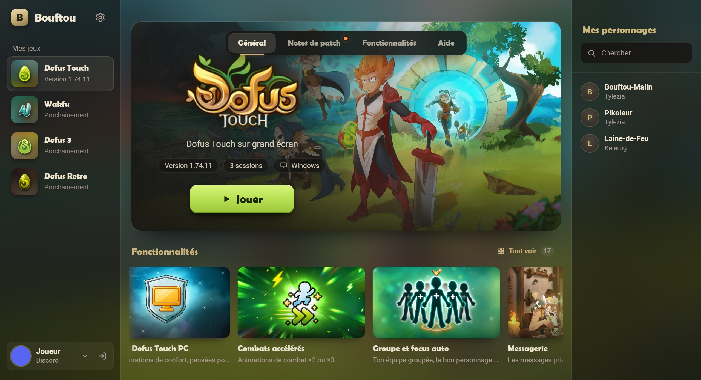

<div align="center">


# 🐑 Bouftou — Dofus Touch sur PC, sans émulateur

**Le client PC ultime pour Dofus Touch.** Fini l'émulateur : avec Bouftou, Dofus Touch se joue comme un vrai jeu PC, avec un comportement natif optimisé de bout en bout.

<sub>🇬🇧 *Play Dofus Touch on PC without an emulator: a French-language Windows client with smart forgemagic, autopilot, gear builder, market tools and multi-account tabs. Open beta from November 14 to 21.*</sub>

[](https://discord.gg/G65tcyqhTW)
[](#beta)
[](#windows)
[](#faq)

### 🧪 Bêta ouverte du samedi 14 novembre 17 h au samedi 21 novembre 17 h

</div>

> [!IMPORTANT]
> **Méfie-toi des copies.** Les seuls endroits officiels de Bouftou sont **ce dépôt** et le **[Discord de Bouftou](https://discord.gg/G65tcyqhTW)**. Ne télécharge jamais Bouftou ailleurs, et ne donne jamais ton mot de passe Ankama ni ton code Shield à personne.

---

## ✨ Ce qui t'attend

- **+50 améliorations de confort** : tout au survol, raccourcis clavier, combats accélérés, états et barres de vie au-dessus des combattants… fini l'appui long
- **🔨 Forgemagie intelligente** : fixe le jet que tu veux, Bouftou choisit et pose les runes pour toi
- **🧭 Pilote automatique** : choisis ta destination, ton personnage y va tout seul, zaaps et transports compris
- **🎯 Assistant Harebourg** : la bonne case à viser malgré la confusion du Comte
- **📖 Encyclopédie complète** : tous les objets du jeu, recettes, crafts et brisages rentables
- **🛡️ Stuffer façon DofusBook**, intégré au jeu : construis ton stuff, vois tes dégâts, et laisse le Stuffer intelligent trouver le meilleur pour ta classe
- **🗺️ Zones rentables** : les meilleures zones de farm classées en kamas, au prix de ton serveur
- **💰 Hôtel de vente** : les prix de ton serveur suivis en continu, où investir, tes lots dépassés
- **📅 Almanax** : l'offrande du jour, le calendrier et ta liste de courses
- **🖥️ Une interface pensée pour le PC** : tous tes comptes en onglets, écran partagé, tout à la souris

## 📸 En images

<p align="center">
  
  <br><em>Le lanceur : tes jeux, tes personnages et toutes les fonctionnalités, avant même d'entrer en jeu.</em>
</p>

<p align="center">
  
  
  
  
  
  
</p>


## 🔁 Tu jouais sur Lindo ?

Lindo a permis à des milliers de joueurs de jouer à Dofus Touch sur PC, mais aucune nouvelle version n'est sortie depuis 2022. Bouftou repart du même principe, le jeu d'Ankama dans une vraie fenêtre PC sans émulateur, et va beaucoup plus loin : forgemagie intelligente, pilote automatique, Stuffer, encyclopédie, zones rentables, hôtel de vente, Almanax… Le tout dans un client suivi de près, avec un Discord pour remonter tes bugs et tes idées.

## 🔍 Comment ça marche, sans zone d'ombre

1. **Téléchargement** : Bouftou récupère les fichiers de Dofus Touch directement chez Ankama, comme l'application mobile.
2. **Adaptation au PC** : des correctifs font tourner le jeu hors de l'application Android, et les clics de ta souris deviennent des touchers.
3. **Jeu en local** : le jeu est servi depuis ton propre ordinateur et affiché dans la fenêtre de Bouftou. Il se met à jour tout seul à chaque version d'Ankama.
4. **Ton compte reste chez Ankama** : tu te connectes à ton compte Ankama comme d'habitude. Ton mot de passe, ton code Shield et les échanges du jeu ne passent jamais par les serveurs de Bouftou.

Ce que Bouftou envoie à ses propres serveurs, et rien d'autre : ton compte Discord pour vérifier ton accès, les jeux ouverts et la version de Bouftou pendant que tu joues, et un rapport de bug seulement si tu choisis d'en envoyer un.

<a id="beta"></a>

## 🚀 Participer à la bêta

1. **Rejoins le [Discord](https://discord.gg/G65tcyqhTW)** et clique sur **« Rejoindre la bêta test »** dans le salon bêta-test. Les préinscriptions sont ouvertes dès maintenant.
2. **Samedi 14 novembre à 17 h**, télécharge Bouftou dans le salon **télécharger** du Discord.
3. **Ouvre Bouftou et connecte-toi avec ton compte Discord** : ton accès bêta s'active tout seul. Puis connecte-toi à ton compte Ankama comme d'habitude.

<a id="windows"></a>

## 🛡️ Premier lancement : avertissement de Windows

Bouftou n'a pas encore de certificat de signature, un abonnement payant que peu de projets indépendants peuvent s'offrir. Au premier lancement, Windows peut donc afficher **« Windows a protégé votre ordinateur »** : clique sur **Informations complémentaires**, puis sur **Exécuter quand même**. C'est normal pour un logiciel indépendant non signé.

**Vérifier ton téléchargement** : l'empreinte SHA-256 de chaque installateur officiel est publiée avec sa version. Pour la comparer, ouvre PowerShell dans le dossier du fichier :

```powershell
Get-FileHash .\Installer-Bouftou.exe -Algorithm SHA256
```

Si l'empreinte affichée est différente, ne lance pas le fichier et préviens-nous sur le Discord.

<a id="faq"></a>

## ❓ Questions fréquentes

**C'est gratuit ?**
Pendant les 7 jours de la bêta ouverte, oui. Ensuite, une licence Bouftou à vie est proposée dans la boutique du Discord.

**Sur quel système ?**
Windows 10 et 11 (64 bits).

**Et mon compte Ankama ?**
Tu te connectes à ton compte Ankama comme d'habitude. Ne donne jamais ton mot de passe ni ton code Shield à personne, même à quelqu'un qui se présente comme l'équipe Bouftou.

**Bouftou existe en anglais ?**
Pas encore : Bouftou est en français pour l'instant.

**Où signaler un bug ou proposer une idée ?**
Dans Bouftou (**Paramètres › Bug ou idée**) ou sur le [Discord](https://discord.gg/G65tcyqhTW).

---

<div align="center">

**[Rejoins la communauté sur Discord](https://discord.gg/G65tcyqhTW)** 🐑

⭐ *Bouftou te plaît ? Une étoile sur ce dépôt aide d'autres joueurs à le trouver.*

<sub>Projet non officiel, non affilié à Ankama. Dofus Touch est une marque d'Ankama.</sub>

</div>
