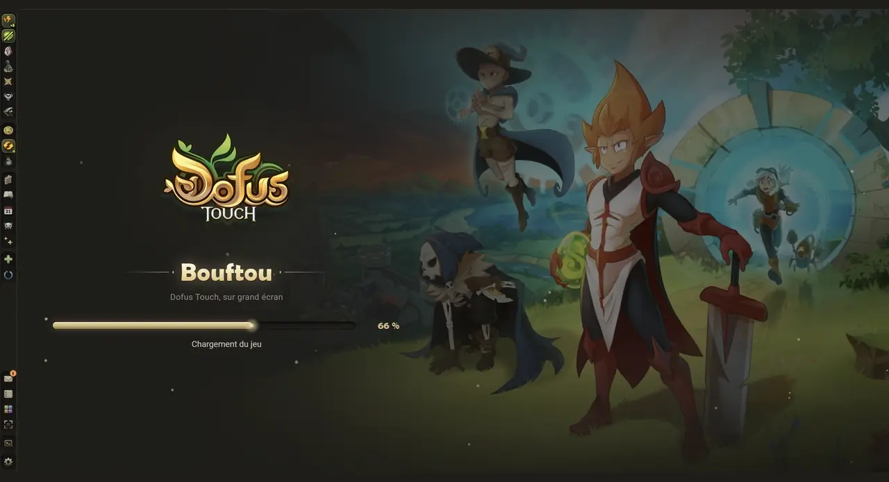
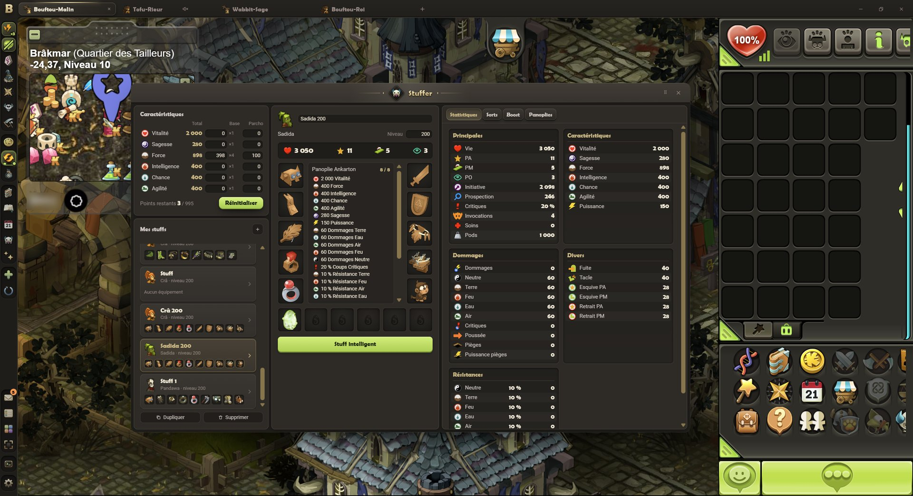
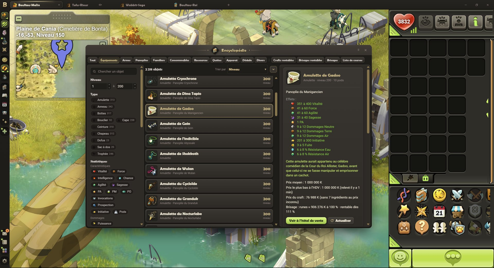
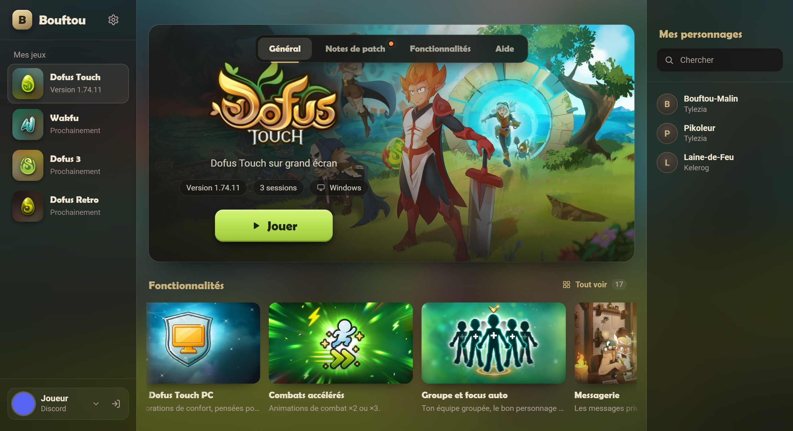
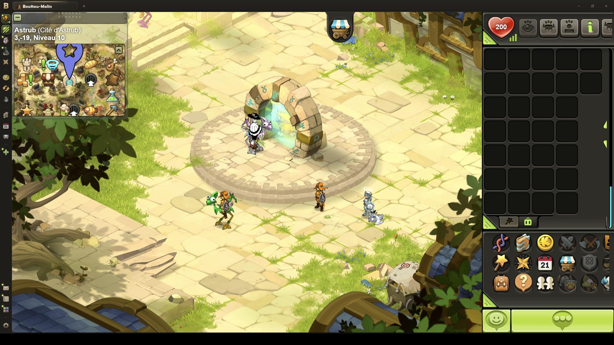
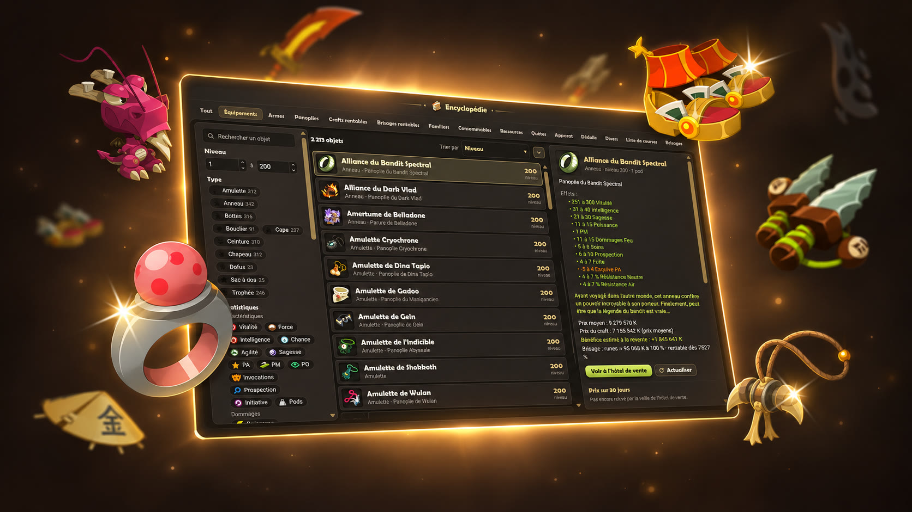
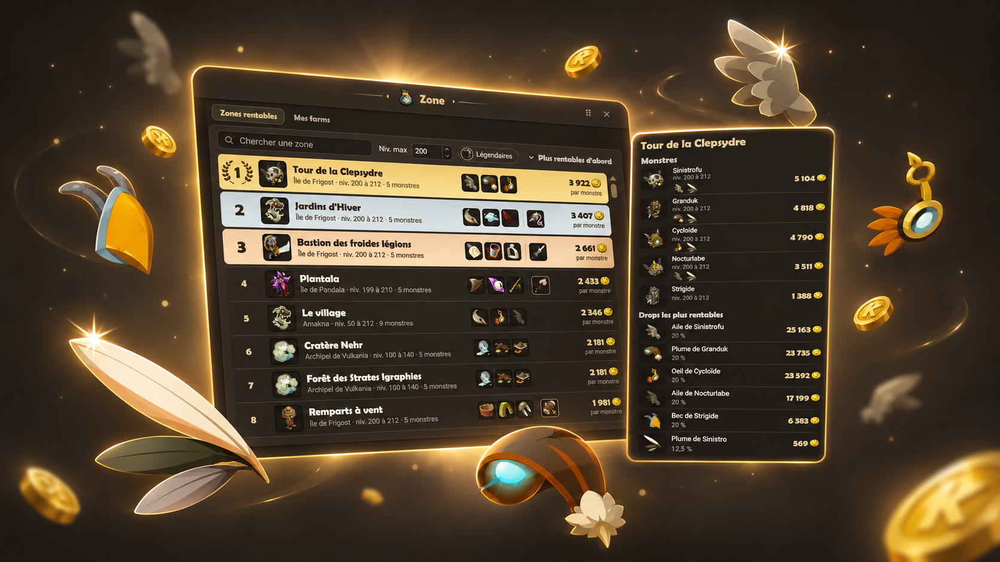
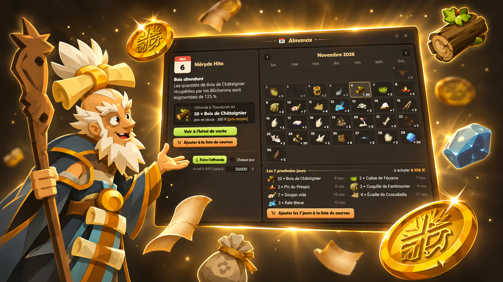

<div align="center">


# 🐑 Bouftou — Dofus Touch sur PC, sans émulateur

**Le client PC ultime pour Dofus Touch.** Fini l'émulateur : avec Bouftou, Dofus Touch se joue comme un vrai jeu PC, avec un comportement natif optimisé de bout en bout.

<sub>🇬🇧 *Play Dofus Touch on PC without an emulator: a French-language client for Windows, macOS and Linux with smart forgemagic, autopilot, gear builder, dungeon guides, market tools and multi-account tabs.*</sub>

[](https://discord.gg/G65tcyqhTW)
[](https://github.com/Wayomingg/Bouftou-Dofus-Touch-PC/releases/latest)
[](https://github.com/Wayomingg/Bouftou-Dofus-Touch-PC/releases/latest)
[](#faq)

[](#installation)
[](#installation)
[](#installation)

**[📥 Télécharger pour Windows](https://github.com/Wayomingg/Bouftou-Dofus-Touch-PC/releases/latest)** · **[🍎 Mac et 🐧 Linux](#installation)** · **[🛡️ Rapport VirusTotal](https://www.virustotal.com/gui/file/85ff92a75d3a203a8f553a72fd59d0b4a7d3da4aa5dea77ee1f63cf09e1f0cea)**

</div>

> [!NOTE]
> **Bouftou n'est pas un serveur privé.** C'est un logiciel pour jouer au vrai Dofus Touch sur PC : tu joues sur les **serveurs officiels d'Ankama**, avec ton compte et tes personnages habituels. Ta progression est la même que sur ton téléphone.

> [!IMPORTANT]
> **Méfie-toi des copies.** Les seuls endroits officiels de Bouftou sont **ce dépôt** et le **[Discord de Bouftou](https://discord.gg/G65tcyqhTW)**. Ne télécharge jamais Bouftou ailleurs, et ne donne jamais ton mot de passe Ankama ni ton code Shield à personne.

---

## ✨ Ce qui t'attend

- **+50 améliorations de confort** : tout au survol, raccourcis clavier, combats accélérés, états et barres de vie au-dessus des combattants… fini l'appui long
- **🔨 Forgemagie intelligente** : fixe le jet que tu veux, Bouftou choisit et pose les runes pour toi
- **🧭 Pilote automatique** : choisis ta destination, ton personnage y va tout seul, zaaps et transports compris
- **🎯 Assistant Harebourg** : la bonne case à viser malgré la confusion du Comte
- **📖 Encyclopédie complète** : tous les objets du jeu, recettes, crafts et brisages rentables
- **🛡️ Stuffer façon DofusBook**, intégré au jeu : construis ton stuff, vois tes dégâts, et laisse le Stuffer intelligent trouver le meilleur pour ta classe
- **🗺️ Zones rentables** : les meilleures zones de farm classées en kamas, au prix de ton serveur
- **💰 Hôtel de vente** : les prix de ton serveur suivis en continu, où investir, tes lots dépassés
- **📅 Almanax** : l'offrande du jour, le calendrier et ta liste de courses
- **📚 Guides des donjons** : tous les donjons du jeu, la stratégie de chaque boss, ses sorts, ses résistances, l'accès et les butins
- **✨ Skinator** : essaie chapeaux, capes, boucliers, familiers et couleurs sur ton personnage, et garde tes tenues préférées
- **🖥️ Une interface pensée pour l'ordinateur** : tous tes comptes en onglets, écran partagé, tout à la souris, sur Windows, Mac et Linux

## 📸 En images

<p align="center">
  
  <br><em>Bouftou en un coup d'œil : le chargement, le jeu, le Stuffer, l'Encyclopédie, les zones rentables, les Guides des donjons, le Skinator et le lanceur.</em>
</p>

<table>
  <tr>
    <td width="50%"><br><sub><b>📚 Guides des donjons</b> : tous les donjons, classés par niveau, avec leur boss.</sub></td>
    <td width="50%"><br><sub><b>🐉 Fiche d'un boss</b> : stratégie pas à pas, caractéristiques, résistances, sorts et butins.</sub></td>
  </tr>
  <tr>
    <td width="50%"><br><sub><b>🛡️ Stuffer</b> : ton stuff, ses panoplies et toutes tes caractéristiques, sans quitter le jeu.</sub></td>
    <td width="50%"><br><sub><b>📖 Encyclopédie</b> : tous les objets du jeu, leurs effets, leur prix à l'HDV, le craft et le brisage rentables.</sub></td>
  </tr>
  <tr>
    <td width="50%"><br><sub><b>🗺️ Zones rentables</b> : les zones de farm classées en kamas par monstre, avec leurs drops les plus rentables.</sub></td>
    <td width="50%"><br><sub><b>✨ Skinator</b> : la cabine d'essayage des apparats, directement sur ton personnage.</sub></td>
  </tr>
  <tr>
    <td width="50%"><br><sub><b>🚀 Le lanceur</b> : tes jeux, tes personnages et toutes les fonctionnalités avant d'entrer en jeu.</sub></td>
    <td width="50%"><br><sub><b>🎮 En jeu</b> : un onglet par personnage, les outils de Bouftou à gauche, la mini-carte.</sub></td>
  </tr>
</table>

<p align="center">
  
  
  
  
  
  
</p>


## 🔁 Tu jouais sur Lindo ?

Lindo a permis à des milliers de joueurs de jouer à Dofus Touch sur PC, mais aucune nouvelle version n'est sortie depuis 2022. Bouftou repart du même principe, le jeu d'Ankama dans une vraie fenêtre PC sans émulateur, et va beaucoup plus loin : forgemagie intelligente, pilote automatique, Stuffer, encyclopédie, zones rentables, hôtel de vente, Almanax… Le tout dans un client suivi de près, avec un Discord pour remonter tes bugs et tes idées.

## 🔍 Comment ça marche, sans zone d'ombre

1. **Téléchargement** : Bouftou récupère les fichiers de Dofus Touch directement chez Ankama, comme l'application mobile.
2. **Adaptation au PC** : des correctifs font tourner le jeu hors de l'application Android, et les clics de ta souris deviennent des touchers.
3. **Jeu en local** : le jeu est servi depuis ton propre ordinateur et affiché dans la fenêtre de Bouftou. Il se met à jour tout seul à chaque version d'Ankama.
4. **Ton compte reste chez Ankama** : tu te connectes à ton compte Ankama comme d'habitude. Ton mot de passe, ton code Shield et les échanges du jeu ne passent jamais par les serveurs de Bouftou.

Ce que Bouftou envoie à ses propres serveurs, et rien d'autre : ton compte Discord pour vérifier ton accès, les jeux ouverts et la version de Bouftou pendant que tu joues, et un rapport de bug seulement si tu choisis d'en envoyer un.

<a id="installation"></a>

## 💻 Installation et premier lancement

| | Système | Fichier | Où le trouver |
|---|---|---|---|
| 🪟 | **Windows** 10 et 11 (64 bits) | `Installer-Bouftou.exe` | [Releases](https://github.com/Wayomingg/Bouftou-Dofus-Touch-PC/releases/latest) ou salon **télécharger** du Discord |
| 🍎 | **macOS** 12 ou plus récent, puce Apple ou Intel | `.dmg` | Salon **télécharger** du [Discord](https://discord.gg/G65tcyqhTW) |
| 🐧 | **Linux** 64 bits | `.AppImage` | Salon **télécharger** du [Discord](https://discord.gg/G65tcyqhTW) |

Bouftou se met ensuite à jour tout seul, sur les trois systèmes.

<a id="windows"></a>

**🪟 Windows.** Bouftou n'a pas encore de certificat de signature, un abonnement payant que peu de projets indépendants peuvent s'offrir. Au premier lancement, Windows peut donc afficher **« Windows a protégé votre ordinateur »** : clique sur **Informations complémentaires**, puis sur **Exécuter quand même**. C'est normal pour un logiciel indépendant non signé.

**🍎 Mac.** Ouvre le `.dmg` et glisse Bouftou sur **Applications**. À la première ouverture, macOS indique qu'il ne peut pas vérifier Bouftou : va dans **Réglages Système › Confidentialité et sécurité**, puis clique sur **Ouvrir quand même**.

**🐧 Linux.** Range le fichier `.AppImage` dans un dossier à toi (par exemple `~/Applications`), rends-le exécutable (`chmod +x Bouftou-*.AppImage`, ou clic droit › **Propriétés › Exécutable**), puis lance-le. Sur Ubuntu 22.04 et plus récent, `libfuse2` peut être nécessaire.

**Vérifier ton téléchargement** : l'empreinte SHA-256 de chaque installateur officiel et son **rapport VirusTotal** sont publiés dans la note de sa [version](https://github.com/Wayomingg/Bouftou-Dofus-Touch-PC/releases). Pour comparer l'empreinte, ouvre PowerShell dans le dossier du fichier :

```powershell
Get-FileHash .\Installer-Bouftou.exe -Algorithm SHA256
```

Si l'empreinte affichée est différente, ne lance pas le fichier et préviens-nous sur le Discord.

<a id="faq"></a>

## ❓ Questions fréquentes

**C'est un serveur privé ?**
Non. Tu joues au vrai Dofus Touch, sur les serveurs officiels d'Ankama, avec ton compte et tes personnages habituels. Bouftou est le logiciel qui fait tourner le jeu sur ton PC.

**Sur quel système ?**
Windows 10 et 11 (64 bits), macOS 12 ou plus récent (puce Apple ou Intel) et Linux 64 bits (AppImage). Voir [Installation](#installation).

**Et mon compte Ankama ?**
Tu te connectes à ton compte Ankama comme d'habitude. Ne donne jamais ton mot de passe ni ton code Shield à personne, même à quelqu'un qui se présente comme l'équipe Bouftou.

**Bouftou existe en anglais ?**
Pas encore : Bouftou est en français pour l'instant.

**Où signaler un bug ou proposer une idée ?**
Dans Bouftou (**Paramètres › Bug ou idée**) ou sur le [Discord](https://discord.gg/G65tcyqhTW).

---

<div align="center">

**[Rejoins la communauté sur Discord](https://discord.gg/G65tcyqhTW)** 🐑

⭐ *Bouftou te plaît ? Une étoile sur ce dépôt aide d'autres joueurs à le trouver.*

<sub>Projet non officiel, non affilié à Ankama. Dofus Touch est une marque d'Ankama.</sub>

</div>
