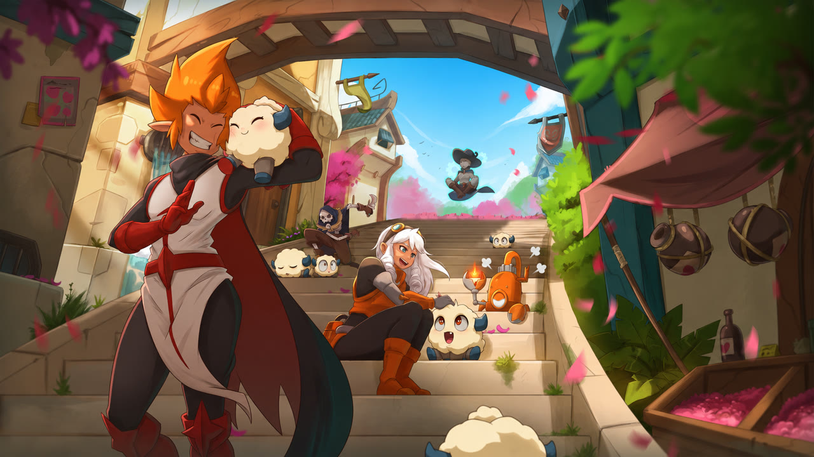
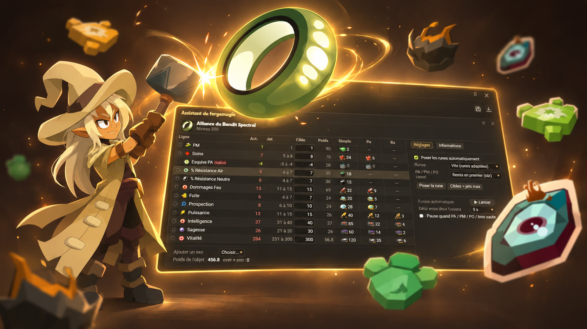
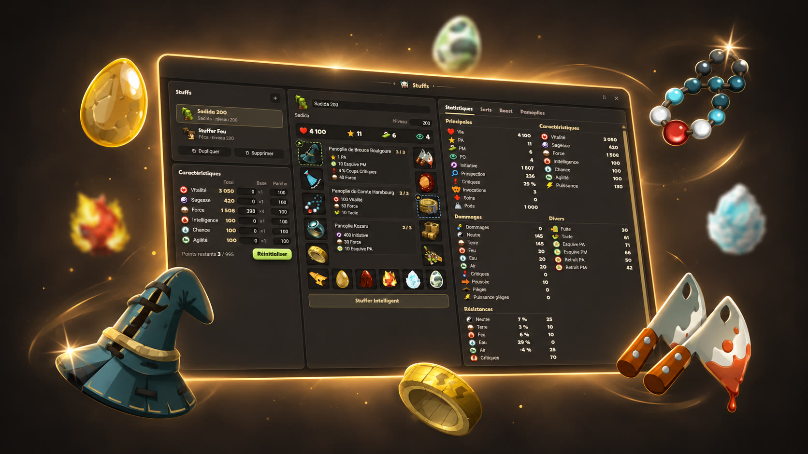
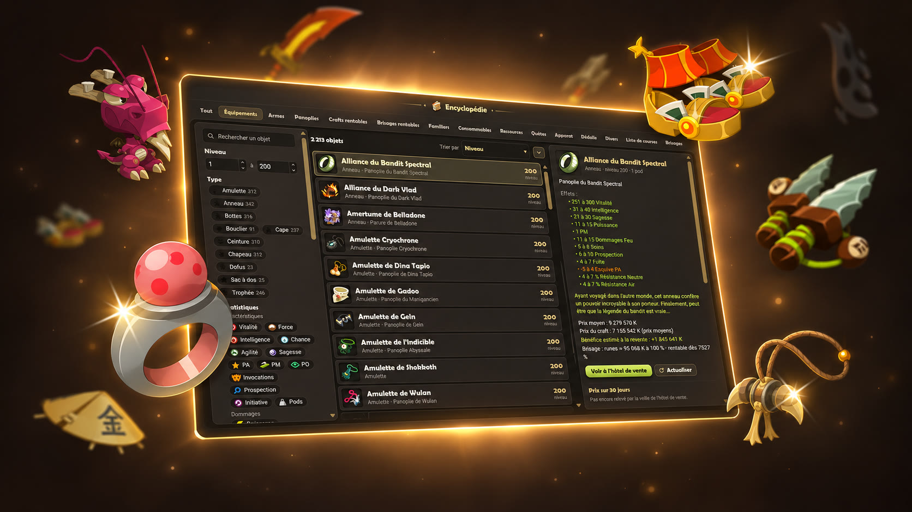
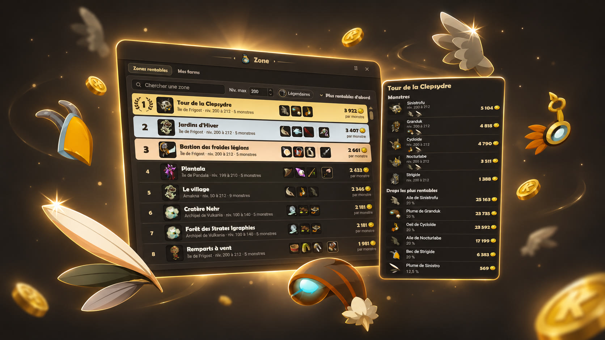
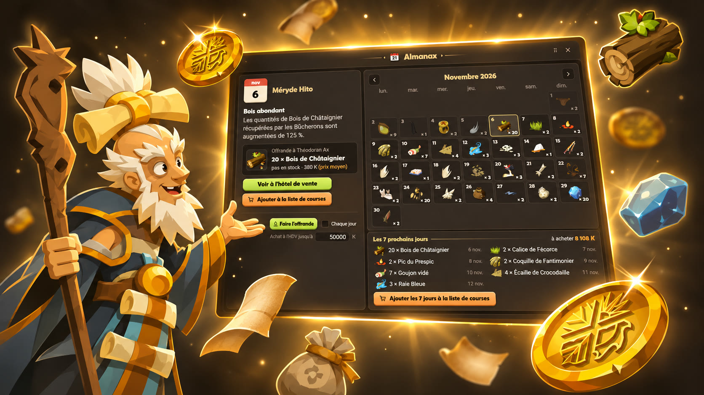
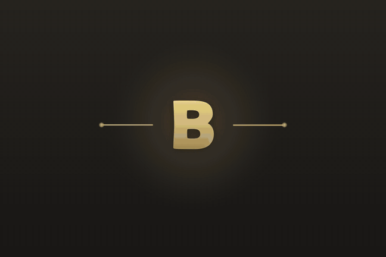

# 🐑 Bouftou — Dofus Touch sur PC, sans émulateur

**Le client PC ultime pour Dofus Touch.** Fini l'émulateur : avec Bouftou, Dofus Touch se joue comme un vrai jeu PC, avec un comportement natif optimisé de bout en bout.

### 🧪 Bêta gratuite du samedi 14 novembre 17 h au samedi 21 novembre 17 h

---

## ✨ Ce qui t'attend

- **+50 améliorations de confort** : tout au survol, raccourcis clavier, combats accélérés, états et barres de vie au-dessus des combattants… fini l'appui long
- **🔨 Forgemagie intelligente** : fixe le jet que tu veux, Bouftou choisit et pose les runes pour toi
- **🧭 Pilote automatique** : choisis ta destination, ton personnage y va tout seul, zaaps et transports compris
- **🎯 Assistant Harebourg** : la bonne case à viser malgré la confusion du Comte
- **📖 Encyclopédie complète** : tous les objets du jeu, recettes, crafts et brisages rentables
- **🛡️ Stuffer façon DofusBook**, intégré au jeu : construis ton stuff, vois tes dégâts, et laisse le Stuffer intelligent trouver le meilleur pour ta classe
- **🗺️ Zones rentables** : les meilleures zones de farm classées en kamas, au prix de ton serveur
- **💰 Hôtel de vente** : les prix de ton serveur suivis en continu, où investir, tes lots dépassés
- **📅 Almanax** : l'offrande du jour, le calendrier et ta liste de courses
- **🖥️ Une interface pensée pour le PC** : tous tes comptes en onglets, écran partagé, tout à la souris

## 📸 En images

  
  
  
  
  
  

  
   <em>Les états de chaque combattant au-dessus de sa tête, avec les tours restants.</em>

## 🚀 Participer à la bêta

1. **Rejoins le [Discord](https://discord.gg/G65tcyqhTW)** et clique sur **« Rejoindre la bêta test »** dans le salon bêta-test. Les préinscriptions sont ouvertes dès maintenant.
2. **Samedi 14 novembre à 17 h**, télécharge Bouftou dans le salon **télécharger** du Discord : c'est le seul lien officiel.
3. **Ouvre Bouftou et connecte-toi avec ton compte Discord** : ton accès bêta s'active tout seul. Puis connecte-toi à ton compte Ankama comme d'habitude.

## ❓ Questions fréquentes

**C'est gratuit ?**
La bêta est gratuite pendant 7 jours. Ensuite, une licence Bouftou à vie est proposée dans la boutique du Discord.

**Sur quel système ?**
Windows 10 et 11 (64 bits).

**Et mon compte Ankama ?**
Tu te connectes à ton compte Ankama comme d'habitude. Ne donne jamais ton mot de passe ni ton code Shield à personne, même à quelqu'un qui se présente comme l'équipe Bouftou.

**Où signaler un bug ou proposer une idée ?**
Dans Bouftou (**Paramètres › Bug ou idée**) ou sur le [Discord](https://discord.gg/G65tcyqhTW).

---

**[Rejoins la communauté sur Discord](https://discord.gg/G65tcyqhTW)** 🐑

Projet non officiel, non affilié à Ankama. Dofus Touch est une marque d'Ankama.

