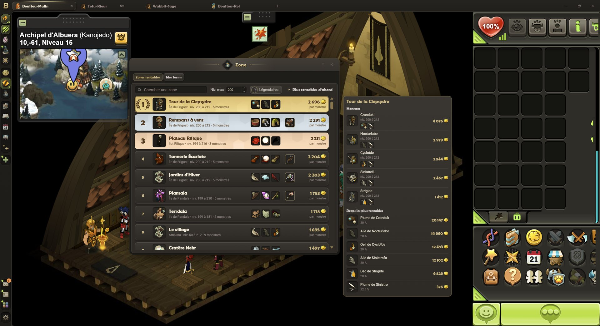
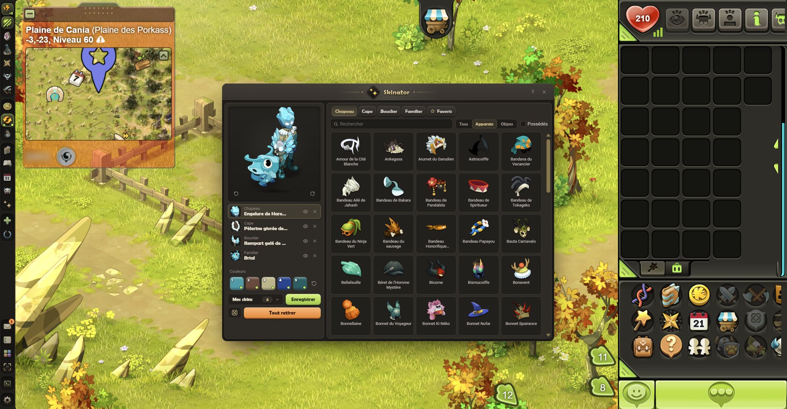

<div align="center">


<a id="francais"></a>

# 🐑 Bouftou — Dofus Touch sur PC, Mac et Linux, sans émulateur

**Joue à Dofus Touch sur PC Windows, Mac et Linux, sans émulateur Android, en français ou en espagnol.** Bouftou adapte le jeu à la souris et au clavier, avec des outils intégrés pour tes équipements, tes déplacements, tes combats et tes comptes. Tu retrouves les serveurs officiels d'Ankama et tes personnages habituels.

**🇫🇷 [Présentation française](#francais) · 🇪🇸 [Presentación en español](#espanol) · 🇬🇧 [English overview](#english)**

<sub>🇪🇸 Juega Dofus Touch en PC, Mac y Linux sin emulador: Bouftou ya está disponible en español.</sub><br>
<sub>🇬🇧 Play Dofus Touch on Windows, macOS and Linux without an Android emulator. Interface available in French and Spanish.</sub>

[](https://discord.gg/FvCvfg3us)
[](https://github.com/Wayomingg/Bouftou-Dofus-Touch-PC/releases/latest)
[](https://github.com/Wayomingg/Bouftou-Dofus-Touch-PC/releases/latest)
[](#francais)
[](#espanol)

[](#installation)
[](#installation)
[](#installation)

**[📥 Télécharger pour Windows](https://github.com/Wayomingg/Bouftou-Dofus-Touch-PC/releases/latest)** · **[🍎 Mac et 🐧 Linux](#installation)** · **[🛡️ Vérifier sur VirusTotal](https://www.virustotal.com/gui/file/c5f6c6b5284f22de83915827f3149853f03313ac4f44e6ca522378b2f9dea8d6)**

</div>

> [!NOTE]
> **Bouftou n'est pas un serveur privé.** C'est un logiciel pour jouer au vrai Dofus Touch sur PC : tu joues sur les **serveurs officiels d'Ankama**, avec ton compte et tes personnages habituels. Ta progression est la même que sur ton téléphone.

> [!IMPORTANT]
> **Méfie-toi des copies.** Les seuls endroits officiels de Bouftou sont **ce dépôt** et le **[Discord de Bouftou](https://discord.gg/FvCvfg3us)**. Ne télécharge jamais Bouftou ailleurs, et ne donne jamais ton mot de passe Ankama ni ton code Shield à personne.

---

## ✨ Ce qui t'attend

- **🇫🇷 Français et 🇪🇸 espagnol** : lanceur, interface et outils de Dofus Touch traduits ; change de langue depuis le drapeau dans la barre de gauche ou les Paramètres
- **+50 améliorations de confort** : tout au survol, raccourcis clavier, combats accélérés, états et barres de vie au-dessus des combattants… fini l'appui long
- **🔨 Forgemagie intelligente** : fixe le jet que tu veux, Bouftou choisit et pose les runes pour toi
- **🧭 Pilote automatique** : choisis ta destination, ton personnage y va tout seul, zaaps et transports compris
- **🎯 Assistant Harebourg** : la bonne case à viser malgré la confusion du Comte
- **📖 Encyclopédie complète** : tous les objets du jeu, recettes, crafts et brisages rentables
- **🛡️ Stuffer façon DofusBook**, intégré au jeu : construis ton stuff, vois tes dégâts, et laisse le Stuffer intelligent trouver le meilleur pour ta classe
- **🗺️ Zones rentables** : les meilleures zones de farm classées en kamas, au prix de ton serveur
- **💰 Hôtel de vente** : les prix de ton serveur suivis en continu, où investir, tes lots dépassés
- **📅 Almanax** : l'offrande du jour, le calendrier et ta liste de courses
- **📚 Guides des donjons** : fiches des boss, sorts, résistances, accès et butins, avec **97 stratégies disponibles en espagnol**
- **✨ Skinator** : essaie chapeaux, capes, boucliers, familiers et couleurs sur ton personnage, et garde tes tenues préférées
- **🖥️ Une interface pensée pour l'ordinateur** : tous tes comptes en onglets, écran partagé, tout à la souris, sur Windows, Mac et Linux
- **🎒 Inventaire partagé** : consulte les objets, kamas et pods des personnages de ton groupe depuis un seul panneau
- **💬 Messagerie unifiée** : lis et réponds aux messages privés de tes personnages sans changer d'onglet

## 📸 En images

<p align="center">
  
  <br><em>Bouftou en un coup d'œil : le chargement, le jeu, le Stuffer, l'Encyclopédie, les zones rentables, les Guides des donjons, le Skinator et le lanceur.</em>
</p>

<table>
  <tr>
    <td width="50%"><br><sub><b>📚 Guides des donjons</b> : tous les donjons, classés par niveau, avec leur boss.</sub></td>
    <td width="50%"><br><sub><b>🐉 Fiche d'un boss</b> : stratégie pas à pas, caractéristiques, résistances, sorts et butins.</sub></td>
  </tr>
  <tr>
    <td width="50%"><br><sub><b>🛡️ Stuffer</b> : ton stuff, ses panoplies et toutes tes caractéristiques, sans quitter le jeu.</sub></td>
    <td width="50%"><br><sub><b>📖 Encyclopédie</b> : tous les objets du jeu, leurs effets, leur prix à l'HDV, le craft et le brisage rentables.</sub></td>
  </tr>
  <tr>
    <td width="50%"><br><sub><b>🗺️ Zones rentables</b> : les zones de farm classées en kamas par monstre, avec leurs drops les plus rentables.</sub></td>
    <td width="50%"><br><sub><b>✨ Skinator</b> : la cabine d'essayage des apparats, directement sur ton personnage.</sub></td>
  </tr>
  <tr>
    <td width="50%"><br><sub><b>🚀 Le lanceur</b> : tes jeux, tes personnages et toutes les fonctionnalités avant d'entrer en jeu.</sub></td>
    <td width="50%"><br><sub><b>🎮 En jeu</b> : un onglet par personnage, les outils de Bouftou à gauche, la mini-carte.</sub></td>
  </tr>
</table>

<p align="center">
  
  
  
  
  
  
</p>


## 🔁 Tu jouais sur Lindo ?

Tu cherches une alternative à Lindo ou aux émulateurs Android comme BlueStacks et LDPlayer pour jouer à Dofus Touch sur ordinateur ? Bouftou propose le jeu d'Ankama dans une fenêtre PC sans émulateur, avec forgemagie intelligente, pilote automatique, Stuffer, encyclopédie, zones rentables, hôtel de vente et Almanax. Le client se met à jour automatiquement et la communauté Discord accueille tes bugs et tes suggestions, en français et en espagnol.

## 🔍 Comment ça marche, sans zone d'ombre

1. **Téléchargement** : Bouftou récupère les fichiers de Dofus Touch directement chez Ankama, comme l'application mobile.
2. **Adaptation au PC** : des correctifs font tourner le jeu hors de l'application Android, et les clics de ta souris deviennent des touchers.
3. **Jeu en local** : le jeu est servi depuis ton propre ordinateur et affiché dans la fenêtre de Bouftou. Il se met à jour tout seul à chaque version d'Ankama.
4. **Ton compte reste chez Ankama** : tu te connectes à ton compte Ankama comme d'habitude. Ton mot de passe, ton code Shield et les échanges du jeu ne passent jamais par les serveurs de Bouftou.

Ce que Bouftou envoie à ses propres serveurs, et rien d'autre : ton compte Discord pour vérifier ton accès, les jeux ouverts et la version de Bouftou pendant que tu joues, et un rapport de bug seulement si tu choisis d'en envoyer un.

<a id="installation"></a>

## 💻 Installation et premier lancement

| | Système | Fichier | Où le trouver |
|---|---|---|---|
| 🪟 | **Windows** 10 et 11 (64 bits) | `Installer-Bouftou.exe` | [Releases](https://github.com/Wayomingg/Bouftou-Dofus-Touch-PC/releases/latest) ou salon **télécharger** du Discord |
| 🍎 | **macOS** 12 ou plus récent, puce Apple ou Intel | `.dmg` | Salon **télécharger** du [Discord](https://discord.gg/FvCvfg3us) |
| 🐧 | **Linux** 64 bits | `.AppImage` | Salon **télécharger** du [Discord](https://discord.gg/FvCvfg3us) |

Bouftou se met ensuite à jour tout seul, sur les trois systèmes.

<a id="windows"></a>

**🪟 Windows.** Bouftou n'a pas encore de certificat de signature, un abonnement payant que peu de projets indépendants peuvent s'offrir. Au premier lancement, Windows peut donc afficher **« Windows a protégé votre ordinateur »** : clique sur **Informations complémentaires**, puis sur **Exécuter quand même**. C'est normal pour un logiciel indépendant non signé.

**🍎 Mac.** Ouvre le `.dmg` et glisse Bouftou sur **Applications**. À la première ouverture, macOS indique qu'il ne peut pas vérifier Bouftou : va dans **Réglages Système › Confidentialité et sécurité**, puis clique sur **Ouvrir quand même**.

**🐧 Linux.** Range le fichier `.AppImage` dans un dossier à toi (par exemple `~/Applications`), rends-le exécutable (`chmod +x Bouftou-*.AppImage`, ou clic droit › **Propriétés › Exécutable**), puis lance-le. Sur Ubuntu 22.04 et plus récent, `libfuse2` peut être nécessaire.

**Vérifier ton téléchargement** : l'empreinte SHA-256 et le lien de vérification VirusTotal de l'installateur Windows sont indiqués dans les notes de sa [version](https://github.com/Wayomingg/Bouftou-Dofus-Touch-PC/releases). Pour comparer l'empreinte, ouvre PowerShell dans le dossier du fichier :

```powershell
Get-FileHash .\Installer-Bouftou.exe -Algorithm SHA256
```

Si l'empreinte affichée est différente, ne lance pas le fichier et préviens-nous sur le Discord.

<a id="espanol"></a>

## 🇪🇸 Dofus Touch en PC sin emulador — Bouftou en español

**Bouftou ya está disponible en español para Windows, macOS y Linux.** Juega a Dofus Touch en tu computadora con mouse y teclado, sin instalar un emulador Android como BlueStacks o LDPlayer. Puedes usar tu cuenta Ankama y tus personajes habituales en los servidores oficiales: **no es un servidor privado**.

### Herramientas y funciones

- **Multicuenta y pantalla dividida:** organiza tus cuentas en pestañas o muéstralas juntas. En combate, cambia automáticamente al personaje al que le toca jugar.
- **Combates más cómodos:** animaciones ×2 y ×3, atajos personalizables, alcance de los hechizos, zonas de efecto y vista previa de los daños.
- **Piloto automático:** elige tu destino, configura los transportes permitidos, guarda favoritos y lleva a tu grupo.
- **Forjamagia inteligente:** define los objetivos de tu equipo y el asistente elige y coloca las runas. También prepara las runas que necesitas retirar del banco.
- **Stuffer, simulador de equipos:** compara sets, características y daños de tus hechizos; usa el optimizador para buscar una combinación de equipos.
- **Skinator:** prueba objetos de apariencia y colores sobre tu personaje, y guarda tus conjuntos favoritos.
- **Enciclopedia:** consulta objetos, sets, recetas, recursos y herramientas para encontrar crafteos y roturas rentables.
- **Mercadillo:** sigue la evolución de precios, tus compras y tus ventas, y detecta ofertas más baratas que las tuyas.
- **Zonas rentables:** compara zonas según sus recursos, los precios de tu servidor y tu prospección.
- **Guías de mazmorras:** consulta jefes, hechizos, resistencias, acceso y botines, con **97 estrategias en español**.
- **Almanax:** revisa la ofrenda del día y el calendario, y prepara los recursos con la lista de compras. La ofrenda automática está desactivada temporalmente.
- **Inventario compartido y mensajería:** consulta los objetos de tu grupo y responde a los mensajes privados de tus personajes desde paneles comunes.
- **Asistente del Conde Kontatrás:** encuentra la casilla a la que debes apuntar durante la confusión.

### Descargar e instalar Bouftou

| Sistema | Archivo | Descarga |
|---|---|---|
| **Windows 10 y 11, 64 bits** | `Installer-Bouftou.exe` | [Releases de GitHub](https://github.com/Wayomingg/Bouftou-Dofus-Touch-PC/releases/latest) o canal **descargar** de Discord |
| **macOS 12 o posterior, Apple Silicon e Intel** | `.dmg` | Canal **descargar** de [Discord](https://discord.gg/FvCvfg3us) |
| **Linux, 64 bits** | `.AppImage` | Canal **descargar** de [Discord](https://discord.gg/FvCvfg3us) |

1. Descarga el archivo para tu sistema. En Mac, abre el `.dmg` y arrastra Bouftou a **Aplicaciones**; en Linux, dale permiso de ejecución al `.AppImage`.
2. Abre el launcher e inicia sesión con tu cuenta Discord para verificar tu acceso a Dofus Touch.
3. Elige **Español** en **Configuración › General** o desde la **bandera de la barra izquierda** del juego.
4. Inicia Dofus Touch con tu cuenta Ankama habitual. Bouftou se actualiza automáticamente en los tres sistemas.

Las capturas de esta página muestran la interfaz francesa. El launcher, los menús y las herramientas también están traducidos al español. El cliente está disponible en **francés y español**; el resumen en inglés de esta página no significa que la interfaz esté traducida al inglés.

**La licencia de Bouftou se compra en la tienda de Discord.** Allí también puedes consultar los precios, las instrucciones de instalación y las huellas SHA-256 de las descargas. Si tu sistema muestra un aviso de seguridad al abrir el archivo, consulta las instrucciones del canal **descargar**.

¿Tienes preguntas, encontraste un bug o quieres hacer una sugerencia? Tenemos espacios de ayuda y notas del parche en español en el **[Discord de Bouftou](https://discord.gg/FvCvfg3us)**.

### Preguntas frecuentes

**¿Es un servidor privado?** No: juegas a Dofus Touch en los servidores oficiales de Ankama, con tu cuenta y tus personajes.

**¿Necesito BlueStacks, LDPlayer o un emulador Android?** No. Bouftou descarga los archivos del juego desde Ankama y los adapta a una ventana de escritorio.

**¿Puedo jugar con varias cuentas?** Sí, puedes organizarlas en pestañas o con pantalla dividida dentro de Bouftou.

**¿Dónde veo las novedades?** En la pestaña de notas del parche del launcher y en el canal **notas-de-parche** de Discord.

Bouftou es un proyecto independiente, no afiliado a Ankama. Dofus Touch es una marca de Ankama.

<a id="english"></a>

## 🇬🇧 In English

**Bouftou lets you play Dofus Touch on PC (Windows), Mac and Linux without an Android emulator** such as BlueStacks or LDPlayer. You play the real Dofus Touch on Ankama's official servers, with your usual account and characters: Bouftou downloads the game files from Ankama, adapts them to a desktop window and turns your mouse clicks into touches.

On top of the game, Bouftou adds smart forgemagic, an autopilot, a DofusBook-style gear builder (Stuffer), dungeon guides for every boss, a full item encyclopedia, profitable farming zones, market (HDV) tracking, the Almanax, a cosmetics fitting room (Skinator) and multi-account tabs with split screen. A modern alternative to Lindo.

The interface is available in **French and Spanish**. See the [Spanish presentation and installation guide](#espanol). Windows installer in the [Releases](https://github.com/Wayomingg/Bouftou-Dofus-Touch-PC/releases/latest); Mac (`.dmg`) and Linux (`.AppImage`) in the **télécharger / descargar** channels of the [Discord](https://discord.gg/FvCvfg3us). A Bouftou license is purchased through the Discord store.

<a id="faq"></a>

## ❓ Questions fréquentes

**C'est un serveur privé ?**
Non. Tu joues au vrai Dofus Touch, sur les serveurs officiels d'Ankama, avec ton compte et tes personnages habituels. Bouftou est le logiciel qui fait tourner le jeu sur ton PC.

**Sur quel système ?**
Windows 10 et 11 (64 bits), macOS 12 ou plus récent (puce Apple ou Intel) et Linux 64 bits (AppImage). Voir [Installation](#installation).

**Et mon compte Ankama ?**
Tu te connectes à ton compte Ankama comme d'habitude. Ne donne jamais ton mot de passe ni ton code Shield à personne, même à quelqu'un qui se présente comme l'équipe Bouftou.

**Dans quelles langues Bouftou est-il disponible ?**
En **français et en espagnol** : lanceur, interface et outils de Dofus Touch. Choisis ta langue dans **Paramètres › Général** ou avec le drapeau de la barre de gauche. L'interface n'est pas encore traduite en anglais.

**Où signaler un bug ou faire une suggestion ?**
Dans Bouftou (**Paramètres › Bug ou suggestion**) ou sur le [Discord](https://discord.gg/FvCvfg3us), qui dispose d'espaces français et espagnols.

---

<div align="center">

**[Rejoins la communauté sur Discord](https://discord.gg/FvCvfg3us)** 🐑

⭐ *Bouftou te plaît ? Une étoile sur ce dépôt aide d'autres joueurs à le trouver.*

<sub>Projet non officiel, non affilié à Ankama. Dofus Touch est une marque d'Ankama.</sub>

</div>
